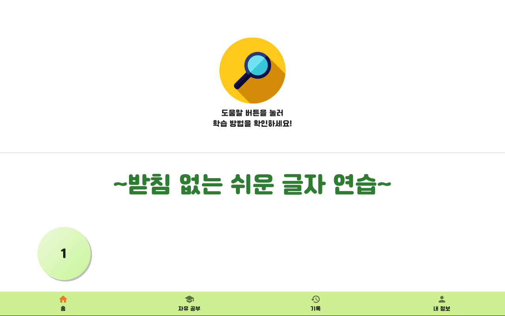
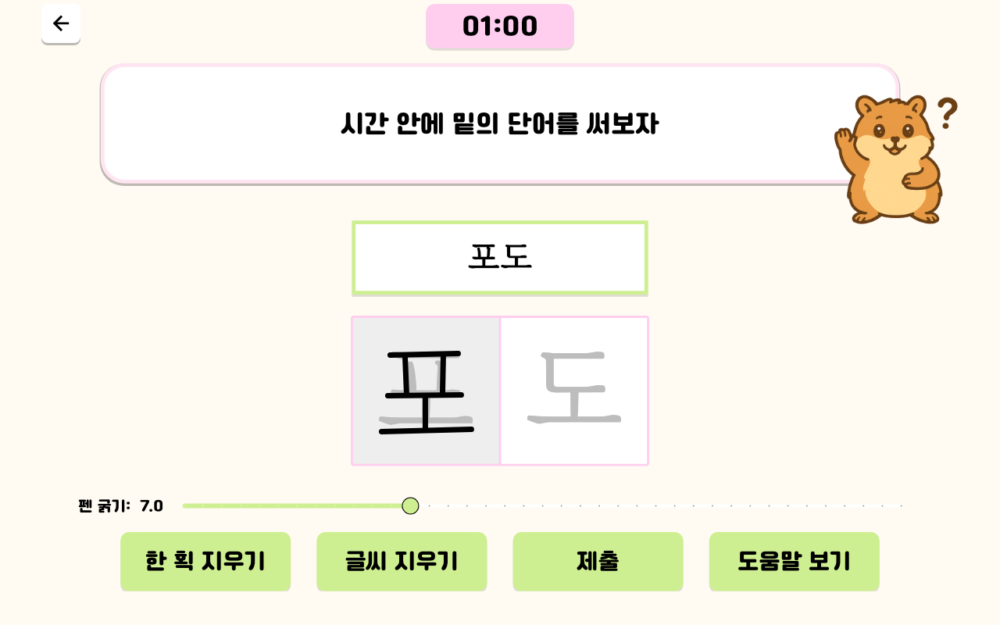
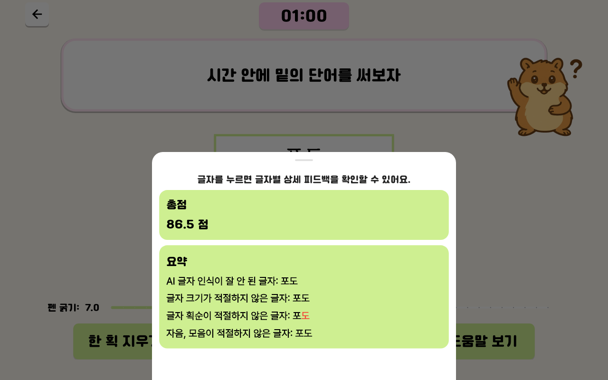
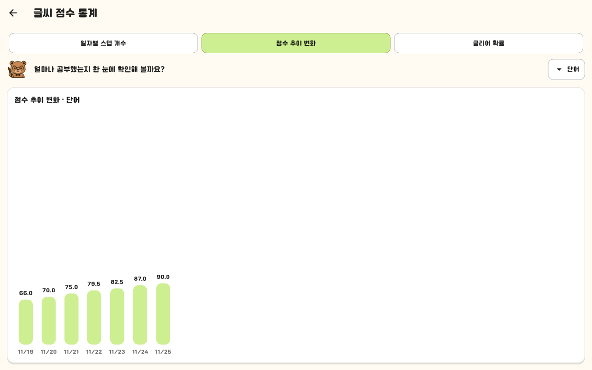
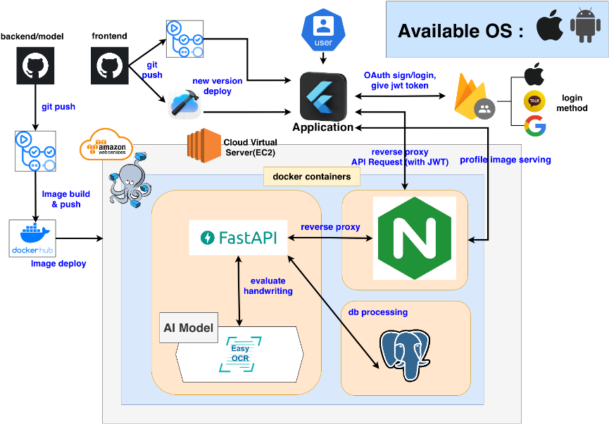

# 손글손글 · Flutter 앱

자음과 모음부터 문장까지 직접 써 보고, AI 피드백으로 글씨를 교정하는 한글 손글씨 연습 앱입니다.

*An app for practicing Korean handwriting with AI feedback.*


<table>
  <tr>
    <th width="50%">홈</th>
    <th width="50%">단계 연습</th>
  </tr>
  <tr>
    <td><a href="docs/screenshots/home.png"></a></td>
    <td><a href="docs/screenshots/practice.png"></a></td>
  </tr>
  <tr>
    <th>평가 결과</th>
    <th>학습 기록</th>
  </tr>
  <tr>
    <td><a href="docs/screenshots/feedback.png"></a></td>
    <td><a href="docs/screenshots/history.png"></a></td>
  </tr>
</table>

화면의 점수와 기록에는 예시 데이터를 사용했습니다.

## 앱에서 할 수 있는 일

- 글자·단어·문장으로 이어지는 단계별 미션을 풀거나, 자유 연습 목록에서 연습할 글자·단어·문장을 골라 씁니다.
- 글씨를 제출하면 가독성, 글자 전체 비율, 획순과 방향, 자모 비율에 대한 점수와 피드백을 받습니다.
- 학습 기록에서 일자별 연습 횟수, 점수 변화, 미션 완료율을 확인합니다.

## 시연 및 다운로드

[](https://youtu.be/hiKP2azsul4)

[시연 영상 2](https://youtu.be/4Eiu8ARfBwU) · [Android APK 다운로드](https://drive.google.com/uc?export=download&id=13mRweaetV0183VmhngQ40QmPLdWyfani)

## 앱과 서버 구성

Flutter 앱이 필기 이미지와 획 좌표를 [FastAPI 서버](https://github.com/AI-WritingCorrection/server)에 보내면, 서버는 글씨를 평가하고 점수와 피드백을 반환합니다. 서버는 로그인과 학습 기록 저장·조회도 처리합니다.



## 지원 환경

- 개발 기준은 Flutter 3.29.2(Dart 3.7.2)입니다. Android 에뮬레이터 또는 기기를 사용할 수 있고, iOS에서 실행하려면 macOS와 Xcode가 필요합니다.
- 필기 연습은 태블릿 가로 화면을 기준으로 합니다. 화면 캡처와 같은 환경에서 확인하려면 가로 모드 태블릿 에뮬레이터를 사용하세요.

## 개발 환경에서 실행

1. 팀원은 팀 Firebase 프로젝트의 앱 설정 파일을 사용합니다. 그 외에는 본인의 Firebase 프로젝트에 앱을 등록해 설정 파일을 받습니다. Android는 `android/app/google-services.json`, iOS는 `ios/Runner/GoogleService-Info.plist`에 둡니다. 사용할 로그인 제공자를 설정하고, 서버에도 같은 Firebase 프로젝트의 서비스 계정 파일을 준비합니다.
2. 저장소 루트에서 환경 파일을 만듭니다. 카카오 로그인을 사용할 때는 `KAKAO_NATIVE_APP_KEY`와 `KAKAO_JAVASCRIPT_APP_KEY`를 채우고, 앱의 네이티브 OAuth 콜백 스킴을 등록한 앱에 맞춥니다.

   ```sh
   cp .env.example .env
   ```

3. [FastAPI 서버의 로컬 실행 가이드](https://github.com/sehwan12/songeul-server#로컬에서-실행)를 따라 서버를 띄웁니다. [`lib/api.dart`](lib/api.dart)의 `_baseUrl`은 Android 에뮬레이터에서 `http://10.0.2.2:8000/api`, iOS 시뮬레이터에서 `http://127.0.0.1:8000/api`로 설정합니다. 실제 기기에서는 같은 네트워크에서 접근할 수 있는 서버 IP나 배포 주소에 `/api`를 붙여 사용합니다.
4. 패키지를 설치하고 앱을 실행합니다.

   ```sh
   flutter pub get
   flutter devices
   flutter run
   ```

로그아웃 상태의 로그인 화면만 확인하려면 `.env`를 만든 뒤 `flutter test test/app_test.dart`를 실행합니다. 이 위젯 테스트에는 Firebase 설정 파일이나 실행 중인 API 서버가 필요하지 않습니다.

## 코드 구조

| 경로 | 역할 |
| --- | --- |
| [`lib/screen/`](lib/screen/) | 홈, 단계 학습, 자유 연습, 기록, 프로필 화면 |
| [`lib/widget/writing/`](lib/widget/writing/) | 필기 캔버스와 획 좌표, 글씨 이미지 처리 |
| [`lib/model/provider/`](lib/model/provider/) | Provider 기반 로그인, 언어, 학습 데이터 상태 |
| [`lib/design_system/`](lib/design_system/) | 앱 테마, 색상·글꼴·간격, 화면 크기 규칙 |
| [`lib/api.dart`](lib/api.dart) | 서버 API 호출 |

공통 스타일은 `app_theme.dart`와 `app_tokens.dart`에 있습니다. 화면 크기에 맞춰 조절하는 요소는 `AppLayout.scale`을 사용합니다. 세로 모드는 화면 너비 390, 가로 모드는 화면 높이 844 논리 픽셀을 기준으로 하며, 배율은 최대 1.0입니다.

## 만든 사람들

| 이름 | 역할 |
| --- | --- |
| 정영진 | 팀장, 프런트엔드 |
| [박세환](https://github.com/sehwan12) | 기획, Flutter 앱 개발(필기 캔버스·API 연동), 서버 개발(학습 통계 API) |
| [류효상](https://github.com/hje1072) | 모델 개발·데이터 수집 및 정리 |
| 신주원 | 모델 개발·데이터 수집 및 정리 |
